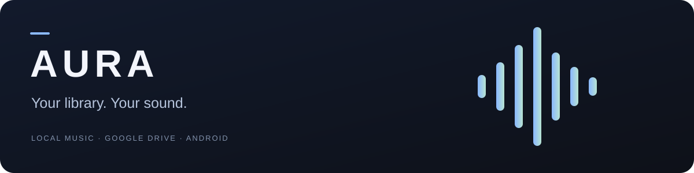
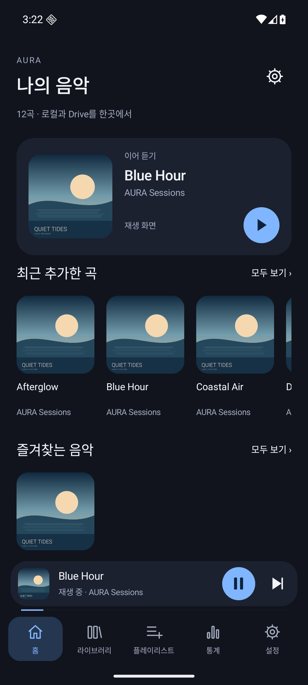
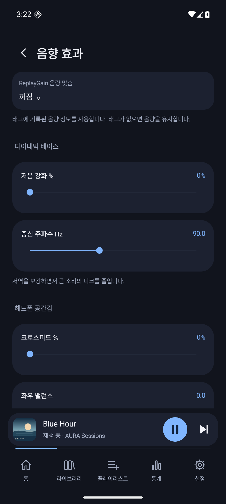
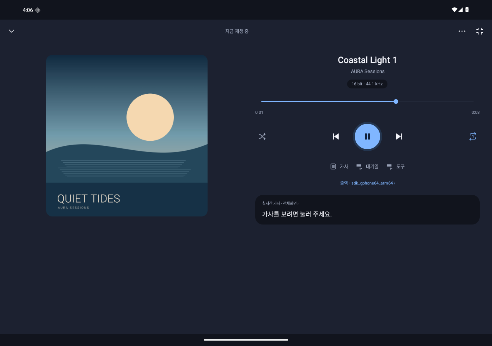

<p align="center">
  
</p>

<p align="center">
  로컬과 Google Drive를 잇는 Android 음악 플레이어<br>
  <sub>Android 8.0 이상 · 다크 / 라이트 · 태블릿 / 폴더블</sub>
</p>

<p align="center">
  <strong><a href="https://github.com/Mobil0010/AURA/releases/latest">최신 버전 다운로드</a></strong>
  &nbsp; · &nbsp;
  <a href="#처음-사용하기">시작하기</a>
  &nbsp; · &nbsp;
  <a href="#자주-묻는-질문">자주 묻는 질문</a>
  &nbsp; · &nbsp;
  <a href="https://github.com/Mobil0010/AURA/issues">문제 제보</a>
</p>

---

## 음악을 모으고, 취향대로 듣고, 기록하세요

<table>
<tr>
<td width="33%" valign="top">
<strong>하나의 라이브러리</strong><br><br>
휴대전화와 Drive의 음악을 함께 탐색하세요. 폴더 구조 그대로 찾고, 좋아하는 곡은 플레이리스트와 즐겨찾기로 모을 수 있습니다.
</td>
<td width="33%" valign="top">
<strong>내 취향의 소리</strong><br><br>
7밴드·파라메트릭 EQ, SoX 리샘플링과 다이내믹 베이스를 제공합니다. 출력 기기에 맞는 음향 프로필도 저장하세요.
</td>
<td width="33%" valign="top">
<strong>감상에 집중하는 화면</strong><br><br>
실시간 가사와 청취 통계, 취침 타이머를 함께 사용하세요. 큰 화면에서는 플레이어와 가사를 나란히 펼칠 수 있습니다.
</td>
</tr>
</table>

## 화면 둘러보기

<table>
<tr><th width="50%">나의 음악</th><th width="50%">음향 효과</th></tr>
<tr>
<td align="center"></td>
<td align="center"></td>
</tr>
</table>

<details>
<summary><strong>태블릿 가로 플레이어 보기</strong></summary>



</details>

<sub>실제 앱의 에뮬레이터 캡처입니다. 화면에는 테스트용 음원·직접 만든 표지를 사용했습니다.</sub>

## 처음 사용하기

### 1. 앱 설치

**현재 버전은 0.20.0입니다.** [최신 릴리스](https://github.com/Mobil0010/AURA/releases/latest)에서 **`AURA-<버전>.apk`**를 받아 실행하세요. `source.zip`은 개발용 소스이며 설치 파일이 아닙니다. Android의 마지막 설치 확인은 직접 진행해야 합니다.

### 2. 내 음악 연결

| 음악이 있는 곳 | 시작 방법 |
| --- | --- |
| 휴대전화·저장소 | 라이브러리에서 음악 폴더를 추가하고 검색합니다. 여러 폴더를 등록할 수 있습니다. |
| Google Drive | 설정에서 Google 계정을 연결하고 음악 폴더를 선택합니다. 등록된 계정 허용 상태에 따라 로그인이 제한될 수 있습니다. |

기본 출력으로 곡을 재생해 본 뒤, 원하는 EQ와 출력 엔진을 선택하세요. 온라인 가사를 사용하려면 설정에서 **LRCLIB 검색**을 켜세요.

### 3. 이후 업데이트

**설정 → 앱 업데이트**에서 확인하고 다운로드할 수 있습니다. 0.18.2 이상은 최신 버전으로 바로 업데이트합니다. 서명 전환 전 버전은 아래 안내를 확인하세요.

[0.20.0 릴리스와 다운로드 파일 보기 →](https://github.com/Mobil0010/AURA/releases/tag/v0.20.0)

## 이런 기능도 있어요

| 감상할 때 | 음악을 관리할 때 |
| --- | --- |
| 실시간 가사·곡별 싱크 보정 | 곡·앨범·아티스트·폴더별 탐색 |
| 취침 타이머·곡/앨범 끝에서 정지 | 최근 추가·즐겨찾기 등 홈 맞춤 모음 |
| 북마크·A–B 구간 반복 | Drive 스트리밍·선택한 음악 오프라인 보관 |
| USB DAC 직접 출력·기기별 음향 프로필 | 일·주·월·전체 청취 통계 |
| Cast·DLNA·같은 Wi-Fi 브라우저 리모컨 | 설정·플레이리스트·청취 기록 백업 |

<details>
<summary><strong>전체 기능과 세부 동작 펼치기</strong></summary>

### 라이브러리와 음악 관리

- 로컬 저장소와 Google Drive를 통합한 곡·앨범·아티스트·폴더 탐색
- 여러 음악 폴더 등록, 폴더 경로 탐색, 폴더 전체 재생 및 선택 폴더만 다시 검색
- 백그라운드 라이브러리 검색, 앱·알림의 진행 표시와 취소
- 앱 시작 시 변경 확인 선택, 기존 정보 재사용 및 새 곡·변경 사항 반영
- 트랙 번호를 포함한 정렬 방식 선택, 플레이리스트와 즐겨찾기
- 홈의 최근 추가한 곡·즐겨찾는 음악·아직 듣지 않은 곡 등 맞춤 모음
- 제목·아티스트·재생 길이를 비교한 중복 후보 확인과 라이브러리 숨김 — 원본 파일은 삭제하지 않습니다.
- 파일 내 앨범아트 우선 사용, 없으면 같은 폴더의 표지 이미지 활용

### Google Drive 스트리밍과 오프라인 보관

- Google 계정 연결 및 선택한 음악 폴더의 읽기 전용 검색
- 음원을 전부 저장하지 않고 필요한 구간을 요청하는 스트리밍과 탐색
- 다음 Drive 곡의 일부를 미리 준비해 곡 전환에 재사용
- 태그·길이·앨범아트 사전 읽기와 기존 정보 재사용
- 사용자가 요청한 곡·앨범·폴더를 앱 내부에 **오프라인 보관**
- 보관 용량 제한과 정리 옵션, 다운로드 알림·취소

일반 스트리밍과 명시적인 오프라인 보관은 구분됩니다. 보관 파일 삭제는 앱 내부 사본에만 적용되며 Drive 원본을 삭제하지 않습니다. 강제 종료 후 미완료 다운로드의 자동 재개는 지원하지 않습니다.

**Google 로그인은 등록된 OAuth 인증서와 계정 허용 상태의 영향을 받습니다.** 모든 Google 계정의 로그인을 보장하지 않으며, 다른 서명으로 직접 빌드하면 해당 인증서를 Google Cloud에 별도로 등록해야 합니다.

### 재생과 출력

- Media3 기반 백그라운드 재생, 시스템 미디어 알림·홈 위젯
- Android 기본 / Hi-Res AudioTrack / USB DAC 직접 출력 선택
- 샘플레이트·비트 깊이·버퍼 설정과 입력·출력 형식 확인
- 지원 경로의 비트퍼펙트 출력 및 DSP 우회
- USB 연결·분리 시 출력 전환과 일시정지 설정
- USB 직접 출력의 앱 볼륨·물리 볼륨 버튼 연동 및 DAC별 볼륨 기억
- 알림·다른 오디오 재생 시 음량 감소·일시정지 관련 설정
- USB 직접 출력 볼륨 팝업: 재생바 위에 표시하고 마지막 조작 후 3초 뒤 자동 닫기
- 백그라운드 볼륨 팝업: 오디오 설정에서 선택하며, 사용 전 ‘다른 앱 위에 표시’ 권한 안내
- 취침 타이머, 현재 곡·앨범 끝에서 정지, 선택적 페이드
- 재생 위치 북마크와 A–B 구간 반복

### 음향 조절

- **고정 7밴드 EQ / 파라메트릭 EQ** 선택과 실시간 주파수 응답 그래프
- EQ 부스트에 따른 자동 프리앰프 보정 켜기·끄기
- SoX `libsoxr` 리샘플링: 품질·위상 응답·컷오프·출력 샘플레이트 조절
- 정수 PCM 출력의 디더링과 노이즈 셰이핑 옵션
- 프리앰프·크로스피드·좌우 밸런스·소프트 리미터
- ReplayGain 트랙·앨범 태그 기반 음량 맞춤
- 자체 구현한 **다이내믹 베이스**: 저음 강화량과 중심 주파수 조절
- 출력 기기별 음향 프로필과 앱 볼륨 상한

다이내믹 베이스는 Sony Clear Bass의 공식 구현이 아닙니다. ReplayGain은 기존 태그를 사용하며, 라이브러리 전체의 음량을 분석해 새 태그를 만드는 기능은 없습니다. 비트퍼펙트에서는 음원을 변경하는 DSP 처리를 우회합니다.

### 가사와 화면

- LRCLIB 자동·수동 검색, 로컬 LRC 우선 적용 및 곡별 LRC 직접 연결
- 전체화면 가사, 줄 싱크와 단어 강조, 곡별 싱크 보정
- 단어별 시간이 있는 가사는 해당 타이밍을 사용하고, 줄 시간만 있으면 줄 구간에 따라 강조를 **추정**합니다.
- 가사 글자 부분을 눌러 해당 재생 위치로 이동
- 다크·라이트 테마 및 앨범아트 원본 비율 유지
- 태블릿·펼친 폴더블의 하단 메뉴 **5/8**, 재생 상태바 **3/8** 배치
- 하단까지 이어지는 오른쪽 플레이어 패널, 전체화면·최소화와 마지막 화면 방식 복원
- 태블릿 가로 전체화면의 앨범아트 왼쪽 / 정보·컨트롤 오른쪽 배치
- 플레이어와 가사를 나란히 보여 주는 분할 화면 및 전환 애니메이션
- 세로로 긴 창에서는 기존 스마트폰 배치 사용

### 통계와 백업

- 일·주·월·전체 기간의 청취 시간과 재생 횟수
- 곡·앨범·아티스트·장르별 순위, 기간 이동과 청취 시간 그래프
- 설정·플레이리스트·청취 기록 등의 JSON 백업·복원

백업에는 로그인 토큰, 서명 키, 음악 파일과 오프라인 음원 사본이 포함되지 않습니다. 복원 후 음악 폴더 접근 권한과 Google 계정을 다시 연결해야 할 수 있습니다. 통계는 AURA가 기록한 감상 내역을 기준으로 합니다.

### 캐스트와 리모컨

- Google Cast / UPnP·DLNA 기기 검색과 재생 제어
- 로컬·Drive 음원 전송: Drive는 휴대전화가 필요한 원본 구간을 중계합니다.
- 같은 Wi-Fi의 다른 기기 브라우저에서 재생·일시정지·곡 이동·탐색 제어

수신 기기의 지원 형식과 네트워크에 따라 동작이 달라집니다. Drive 캐스트에는 EQ·SoX가 적용되지 않습니다. 로컬 음원은 지원 경로에서 현재 EQ·SoX 설정을 반영한 WAV를 준비해 전송합니다. 브라우저 리모컨은 신뢰하는 같은 네트워크에서 사용하며 인터넷 원격 제어 서비스는 아닙니다.
</details>

## 자주 묻는 질문

<details>
<summary><strong>기존 앱을 지우지 않고 업데이트할 수 있나요?</strong></summary>

네. 공식 배포 APK는 기존 설치와의 서명 호환성을 유지합니다. **0.18.2 이상은 최신 버전으로 바로 업데이트**하세요.

서명 전환 전 앱에서는 앱 내 업데이트로 전환용 **0.18.1**을 먼저 설치한 뒤, 앱을 다시 열고 업데이트를 다시 확인하세요. Android 8–12에는 기존 인증서, Android 13 이상에는 새 인증서와 서명 교체 증명(v3.1)을 사용합니다.

`update.json`은 구버전을 위한 고정 전환 피드이고, 전환 이후 앱은 `update-v2.json`에서 최신 버전을 확인합니다. 일반적인 업데이트에 앱 삭제는 필요하지 않습니다.

</details>

<details>
<summary><strong>Play 프로텍트나 외부 출처 설치 안내가 나와요.</strong></summary>

GitHub APK 설치에는 Play 프로텍트 검사 요청이나 제조사의 외부 출처 설치 제한이 나타날 수 있습니다. 배포 서명이 있다고 안내가 사라지는 것은 아닙니다. 설치 파일은 이 저장소의 공식 릴리스에서 받으세요.

</details>

<details>
<summary><strong>Drive 음악은 모두 다운로드해야 하나요?</strong></summary>

아니요. 일반 재생은 필요한 구간을 요청하는 스트리밍입니다. 인터넷 없이 듣고 싶은 곡·앨범·폴더만 별도로 오프라인 보관할 수 있습니다. 보관 사본을 지워도 Drive 원본은 삭제하지 않습니다.

Google 로그인은 OAuth 등록과 계정 허용 상태의 영향을 받으며, 모든 계정의 사용을 보장하지는 않습니다.

</details>

<details>
<summary><strong>모든 폰·USB DAC에서 비트퍼펙트나 Native DSD가 되나요?</strong></summary>

모든 조합을 지원하지는 않습니다. 출력 엔진, Android 버전과 DAC의 지원 형식에 따라 달라집니다. **Native DSD는 미지원**이며 USB 직접 출력은 기기별 검증이 필요한 실험 기능입니다.

아래 호환성 안내를 확인하세요. 출력 문제가 있으면 오류 정보와 기기·DAC 모델을 함께 제보해 주세요.

</details>

<details>
<summary><strong>가사가 단어마다 정확하게 움직이나요?</strong></summary>

단어별 타임스탬프가 있으면 해당 시간을 사용합니다. 줄 시간만 있는 가사는 줄 구간을 나누어 강조하므로 실제 발음과 다를 수 있습니다. 곡별 싱크 보정과 로컬 LRC 연결도 제공합니다.

</details>

## 호환성과 현재 제한

| 항목 | 지원 범위와 주의점 |
| --- | --- |
| Android | 최소 Android 8.0. 기능별 OS·하드웨어 요구사항은 다릅니다. |
| Hi-Res | 실제 출력 형식은 기기·드라이버·연결 장치가 허용하는 범위에 따릅니다. 설정값만으로 고해상도 출력을 보장하지 않습니다. |
| Android 공식 비트퍼펙트 | Android 14 이상에서 지원 USB 경로를 조회·요청합니다. 모든 기기가 지원하는 기능은 아닙니다. |
| USB 직접 출력 | libusb 기반 UAC1/UAC2 PCM 엔진이며 장치별 실기기 검증이 필요한 실험 기능입니다. 모든 DAC의 동작을 보장하지 않습니다. |
| DSD | 비압축 DSF/DSDIFF의 PCM 변환과 DoP 경로가 있습니다. **Native DSD는 미지원**이며 출력 장치·경로 제약이 있습니다. |
| Drive | 계정 허용 상태, 네트워크, 파일 형식·태그에 따라 사용 가능 범위가 다릅니다. |
| 저사양·폴더블 | Android 9 및 최신 Android 에뮬레이터에서 기능·화면을 검사했습니다. 모든 실제 NW-ZX507·갤럭시·태블릿·폴더블 조합의 검증을 의미하지 않습니다. |

0.19.0은 공개 0.18.2 위에 Android 9/API 28과 API 36 에뮬레이터에서 삭제 없이 업데이트 설치·실행을 확인했습니다. 해당 릴리스의 공개 APK 두 개와 두 업데이트 피드를 다시 받아 크기·SHA-256·서명을 검증했습니다.


## 개발자를 위한 안내

<details>
<summary><strong>소스 다운로드 · 빌드 · 검사 방법</strong></summary>

**현재 대응 소스·개발 문서·네이티브 라이선스는 각 릴리스의 `AURA-<버전>-source.zip`으로 제공합니다.** GitHub 기본 브랜치만 복제했을 때와 릴리스 소스 ZIP의 구성은 다를 수 있습니다. APK에 대응하는 소스를 빌드하려면 해당 버전의 ZIP을 사용합니다.

[0.20.0 대응 소스 다운로드](https://github.com/Mobil0010/AURA/releases/download/v0.20.0/AURA-0.20.0-source.zip)

### 개발 빌드

필요한 도구:

- JDK 17
- Android SDK Platform 36
- Android NDK `27.2.12479018`
- CMake `3.22.1`

소스 ZIP을 풀고 Android Studio에서 프로젝트를 연 뒤 SDK 경로를 설정합니다. 명령줄에서도 프로젝트 루트에서 빌드할 수 있습니다.

```sh
./gradlew :app:assembleDebug
```

결과: `app/build/outputs/apk/debug/app-debug.apk`

직접 만든 debug APK는 공개 배포 APK와 서명이 다르므로 기존 공개 앱에 그대로 덮어 설치할 수 없습니다. 개발 빌드용 Google 로그인도 별도 OAuth 인증서 등록이 필요할 수 있습니다.

### 검사

```sh
# JVM 가사·HTTP·원격 명령 검사
bash tools/test-core.sh

# 개발 앱과 Android 테스트 앱 빌드 및 정적 검사
./gradlew :app:assembleDebug :app:assembleDebugAndroidTest :app:lintDebug

# 연결한 에뮬레이터/검사 기기에서 Android 테스트 실행
./gradlew :app:connectedDebugAndroidTest
```

테스트는 전용 테스트 기기·에뮬레이터에서 실행합니다. 화면 크기에 따라 일부 항목은 생략되며, 네트워크 모의 검사는 실제 Google 계정·DAC·캐스트 기기 검사를 대신하지 않습니다.

배포 APK는 보존한 배포 키와 서명 교체 증명으로 만듭니다. 개인 키는 공개 소스에 포함하지 않으며, 소스만으로 공식 서명 APK를 재생성할 수는 없습니다.

### 소스 ZIP에 포함된 문서

| 경로 | 내용 |
| --- | --- |
| `docs/VALIDATION.md` | 검사 결과와 검증하지 않은 범위 |
| `docs/FEATURES-WIP.md` | 추가 기능의 세부 동작·제한 및 개발 당시 기록 |
| `docs/COMPATIBILITY.md` | 오디오 출력·장치 호환성 |
| `docs/SIGNING-MIGRATION.md` | 서명 전환과 기존 설치의 업데이트 경로 |
| `docs/GOOGLE_DRIVE.md` | Drive 연결·인증·데이터 처리의 개발 기록 |
| `docs/NATIVE_BUILD.md` | 네이티브 소스·빌드·라이선스 |

과거 문서의 ‘미배포’ 표시는 해당 검사 시점의 기록입니다. 일부 이전 문서에는 이후 추가된 기능이 반영되지 않았을 수 있으므로 최신 릴리스 설명과 버전을 함께 확인합니다.

</details>

## 개인정보와 라이선스

- 음악 폴더·태그·썸네일·가사 캐시·청취 기록은 기능을 위해 기기에 저장됩니다. 사용자가 선택한 오프라인 음원도 앱 내부에 보관됩니다.
- Google 인증·파일 요청, LRCLIB 검색, GitHub 업데이트 확인, 캐스트·LAN 리모컨에는 각 서비스 또는 연결 기기와의 통신이 필요합니다.
- 서명 개인 키와 인증 토큰은 공개 배포 파일에 포함하지 않습니다. 문제 제보에 로그인 정보·토큰·서명 키를 첨부하지 마세요.
- `libsoxr`, `libusb` 등 제3자 구성 요소의 소스와 라이선스는 대응 소스 ZIP의 `vendor/` 및 네이티브 빌드 문서에서 확인할 수 있습니다.
- 음원·앨범아트·가사의 권리는 각 권리자에게 있습니다. 앱 배포가 해당 콘텐츠의 재배포 권한을 제공하지는 않습니다.


## 도움이 필요하다면

[GitHub Issues에 제보하기 →](https://github.com/Mobil0010/AURA/issues)

**앱 버전 · Android 버전 · 기기/DAC 모델 · 재현 순서 · 오류 정보**를 함께 알려 주세요. 계정 이메일과 개인 파일 경로는 가리고, 로그인 토큰이나 서명 키는 첨부하지 마세요.

---

<p align="center"><sub>AURA · 음악은 한곳에, 소리는 내 취향대로.</sub></p>
